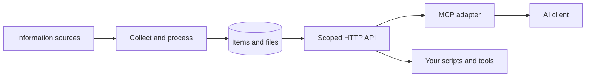

# Inbox Hub

**One inbox for scattered information. A focused feed for your AI.**

[English](README.md) · [Русский](README.ru.md)


[](LICENSE)
[](mcp_adapter/README.md)

Inbox Hub is a self-hosted service that collects messages, materials, and attachments into a feed for AI clients. Organize channels into categories, give each client access to the categories it needs, and retrieve new or updated items through HTTP or the Model Context Protocol (MCP).

Use it to prepare a daily briefing, catch up on a project, or find the materials behind an upcoming deadline. Your AI client writes the summary; Inbox Hub supplies the context and enforces access to it.

## What it does

- **Brings context together.** Keeps items and attachments in one local store, grouped into categories such as work, study, and announcements.
- **Extracts attachment text.** Reads PDF, DOCX, PPTX, XLSX, notebooks, text files, and ZIP archives so clients can retrieve content as well as originals.
- **Surfaces changes.** Tracks edits and replaced attachments; changed items become available again to clients that previously received them.
- **Keeps feeds independent.** Each API key has its own category scope and Received state. A daily briefing does not consume another client's feed.
- **Fits your workflow.** Offers an HTTP API, an MCP adapter, CLI management, and a declarative YAML catalog.

## A briefing, for example

Ask an MCP-connected client:

> What changed in my work channels yesterday? Highlight deadlines and link to the original materials.

The client retrieves the relevant window and categories. The equivalent HTTP request is:

```bash
curl --get http://127.0.0.1:8000/items \
  -H "Authorization: Bearer $INBOX_TOKEN" \
  --data-urlencode 'from=2026-10-01T00:00:00+03:00' \
  --data-urlencode 'to=2026-10-02T00:00:00+03:00' \
  --data-urlencode 'categories=work'
```

An illustrative response excerpt, with fictional data:

```json
{
  "items": [
    {
      "id": 42,
      "channel": "Project announcements",
      "categories": ["work"],
      "text": "The project brief was updated. Please send feedback by October 3.",
      "published_at": "2026-10-01T09:00:00+03:00",
      "edited": true,
      "files": [
        {
          "name": "project-brief.pdf",
          "text": "Review deadline: October 3. The delivery schedule has been updated.",
          "text_status": "ok"
        }
      ]
    }
  ],
  "count": 1
}
```

The client could turn this into:

> **Project brief updated.** Feedback is due October 3. The attachment includes a revised delivery schedule.

This is a documentation example, not a hosted demo. Full responses include item metadata, source links when available, and file identifiers; see the [API guide](docs/api.md). Clients can mark items Received after processing them.

## How it works



The server stores data in SQLite and local files. The MCP adapter runs beside your AI client and talks to the server over HTTP locally or HTTPS remotely. The server enforces category access using the API key supplied by the client.

## Quick start

You need **Python 3.14+**, [uv](https://docs.astral.sh/uv/getting-started/installation/), and source credentials described in the [configuration guide](docs/configuration.md). The following example connects a Telegram chat.

### 1. Install and configure

```bash
git clone https://github.com/umerenkovmaksim/inbox-hub.git
cd inbox-hub
uv sync --locked
cp .env.example .env
uv run python -c "import secrets; print(secrets.token_urlsafe(32))"
```

Fill in `.env`, using the generated value for `API__TOKEN`. Then initialize the database and authorize your account once:

```bash
uv run inbox-hub init-db
uv run inbox-hub login
```

### 2. Start the service

Keep these running in **two separate terminals**, from the repository root:

```bash
# Terminal 1: collector
uv run inbox-hub collect
```

```bash
# Terminal 2: API and scheduled jobs
uv run inbox-hub serve
```

### 3. Choose a chat and create a client key

In a third terminal, wait for the collector's first pass, then list the available chats:

```bash
uv run inbox-hub list-chats
uv run inbox-hub categories create work --title "Work"
# Replace the fictional ID with one from list-chats.
uv run inbox-hub chats add -1001234567890 --category work
uv run inbox-hub keys create work-briefing --category work
```

The key is printed once. Save it, then check access:

```bash
export INBOX_TOKEN="PASTE_THE_GENERATED_KEY"
curl http://127.0.0.1:8000/me -H "Authorization: Bearer $INBOX_TOKEN"
```

Newly tracked chats are picked up within a minute. To connect an AI client, follow the [MCP setup guide](mcp_adapter/README.md), using this scoped key.

## Documentation

| Guide | Contents |
| --- | --- |
| [Configuration](docs/configuration.md) | Credentials, source settings, extraction limits |
| [Categories and catalog](docs/catalog.md) | Channels, scoped keys, YAML plan/apply/export |
| [HTTP API](docs/api.md) | Endpoints, time windows, access and Received semantics |
| [MCP adapter](mcp_adapter/README.md) | Client configuration and independent profiles |
| [Deployment](docs/deployment.md) | Docker, systemd, process lifecycle and data |
| [Upgrading](docs/migrations.md) | Earlier installations and the former Study Inbox setup |
| [Contributing](CONTRIBUTING.md) | Development setup and checks |
| [Domain glossary](CONTEXT.md) | Project terminology |

## Current boundaries

- This is a backend service with CLI and API access. Summarization runs in your chosen AI client.
- Scanned PDFs are marked `needs_ocr`; OCR is not included.
- Run one collector per account session and one API worker. See [deployment](docs/deployment.md) for details.
- Keep credentials, session files, your catalog, and collected data private. Use scoped API keys for clients; reserve the admin token for administration.

## License

[MIT](LICENSE) © 2026 Maksim.
