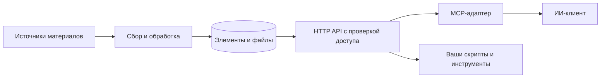

# Inbox Hub

**Единый inbox для разрозненных материалов. Нужный контекст для вашего ИИ.**

[English](README.md) · [Русский](README.ru.md)


[](LICENSE)
[](mcp_adapter/README.ru.md)

Inbox Hub — сервис на вашем сервере, который собирает сообщения, материалы и вложения в общую ленту для ИИ-клиентов. Объединяйте каналы в категории, выдавайте каждому клиенту доступ к нужным категориям и получайте новые или изменённые элементы через HTTP API или Model Context Protocol (MCP).

Используйте его для ежедневной сводки, погружения в проект или поиска материалов к ближайшему дедлайну. Сводку составляет ваш ИИ-клиент; Inbox Hub предоставляет контекст и проверяет права доступа к нему.

## Возможности

- **Материалы в одном месте.** Элементы и вложения хранятся локально и распределяются по категориям: работа, учёба, анонсы и другим.
- **Текст из вложений.** Поддерживаются PDF, DOCX, PPTX, XLSX, блокноты, текстовые файлы и ZIP-архивы. Клиент получает и содержимое, и оригиналы.
- **Отслеживание изменений.** Правки текста и замена вложений возвращают элемент в ленту клиентов, которые уже получали его раньше.
- **Независимые ленты.** У каждого API-ключа свои категории и отметки Received. Ежедневная сводка не скрывает материалы от другого клиента.
- **Удобное подключение.** HTTP API, MCP-адаптер, управление через CLI и декларативный каталог в YAML.

## Например, ежедневная сводка

Попросите клиента с подключённым MCP:

> Что изменилось в моих рабочих каналах за вчера? Выдели дедлайны и дай ссылки на исходные материалы.

Клиент запрашивает нужный промежуток времени и категории. Эквивалентный HTTP-запрос:

```bash
curl --get http://127.0.0.1:8000/items \
  -H "Authorization: Bearer $INBOX_TOKEN" \
  --data-urlencode 'from=2026-10-01T00:00:00+03:00' \
  --data-urlencode 'to=2026-10-02T00:00:00+03:00' \
  --data-urlencode 'categories=work'
```

Сокращённый пример ответа на вымышленных данных:

```json
{
  "items": [
    {
      "id": 42,
      "channel": "Анонсы проекта",
      "categories": ["work"],
      "text": "Описание проекта обновлено. Пришлите замечания до 3 октября.",
      "published_at": "2026-10-01T09:00:00+03:00",
      "edited": true,
      "files": [
        {
          "name": "project-brief.pdf",
          "text": "Замечания принимаются до 3 октября. График поставки обновлён.",
          "text_status": "ok"
        }
      ]
    }
  ],
  "count": 1
}
```

На его основе клиент может составить сводку:

> **Описание проекта обновлено.** Замечания нужно прислать до 3 октября. Во вложении — новый график поставки.

Это пример в документации. Развёрнутого публичного демо нет. Полный ответ включает метаданные элемента, ссылки на источники, если они доступны, и идентификаторы файлов; подробнее — в [руководстве по API](docs/api.md). После обработки клиент может отметить элементы как Received.

## Как это работает



Сервер хранит данные в SQLite и локальных файлах. MCP-адаптер запускается рядом с ИИ-клиентом и обращается к серверу по HTTP локально или HTTPS удалённо. Сервер проверяет доступ к категориям по API-ключу клиента.

## Быстрый старт

Понадобятся **Python 3.14+**, [uv](https://docs.astral.sh/uv/getting-started/installation/) и учётные данные из [руководства по настройке](docs/configuration.md). В примере ниже подключается один Telegram-чат.

### 1. Установка и настройка

```bash
git clone https://github.com/umerenkovmaksim/inbox-hub.git
cd inbox-hub
uv sync --locked
cp .env.example .env
uv run python -c "import secrets; print(secrets.token_urlsafe(32))"
```

Заполните `.env`, указав сгенерированное значение в `API__TOKEN`. Затем создайте базу и один раз авторизуйте аккаунт:

```bash
uv run inbox-hub init-db
uv run inbox-hub login
```

### 2. Запуск сервиса

Запустите процессы в **двух отдельных терминалах**, из корня репозитория:

```bash
# Терминал 1: коллектор
uv run inbox-hub collect
```

```bash
# Терминал 2: API и задания по расписанию
uv run inbox-hub serve
```

### 3. Выбор чата и создание ключа клиента

В третьем терминале дождитесь первой сверки коллектора и получите список чатов:

```bash
uv run inbox-hub list-chats
uv run inbox-hub categories create work --title "Работа"
# Замените вымышленный ID на значение из list-chats.
uv run inbox-hub chats add -1001234567890 --category work
uv run inbox-hub keys create work-briefing --category work
```

Ключ печатается один раз. Сохраните его и проверьте доступ:

```bash
export INBOX_TOKEN="PASTE_THE_GENERATED_KEY"
curl http://127.0.0.1:8000/me -H "Authorization: Bearer $INBOX_TOKEN"
```

Коллектор подхватит новый чат в течение минуты. Для подключения ИИ-клиента используйте этот ключ и [руководство по MCP](mcp_adapter/README.ru.md).

## Документация

| Руководство | Содержание |
| --- | --- |
| [Настройка](docs/configuration.md) | Учётные данные, параметры источников, ограничения извлечения текста |
| [Категории и каталог](docs/catalog.md) | Каналы, права ключей, YAML plan/apply/export |
| [HTTP API](docs/api.md) | Эндпоинты, временные окна, доступ и отметки Received |
| [MCP-адаптер](mcp_adapter/README.ru.md) | Настройка клиента и независимые профили |
| [Развёртывание](docs/deployment.md) | Docker, systemd, процессы и данные |
| [Обновление](docs/migrations.md) | Старые установки и переход со Study Inbox |
| [Участие в разработке](CONTRIBUTING.md) | Окружение и проверки |
| [Словарь](CONTEXT.md) | Терминология проекта |

Руководства по эксплуатации и инструкции по разработке ведутся на английском языке.

## Текущие ограничения

- Это серверный сервис с CLI и API. Сводки составляет выбранный вами ИИ-клиент.
- PDF без текстового слоя получает статус `needs_ocr`; OCR не входит в проект.
- На одну сессию аккаунта запускается один коллектор, API работает с одним воркером. Подробнее — в [руководстве по развёртыванию](docs/deployment.md).
- Учётные данные, файлы сессий, личный каталог и собранные материалы должны оставаться приватными. Клиентам выдаются API-ключи с нужными категориями; admin-токен используется для администрирования.

## Лицензия

[MIT](LICENSE) © 2026 Maksim.
